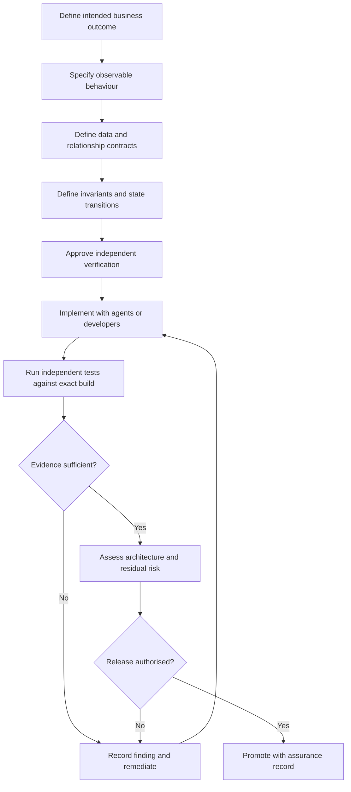
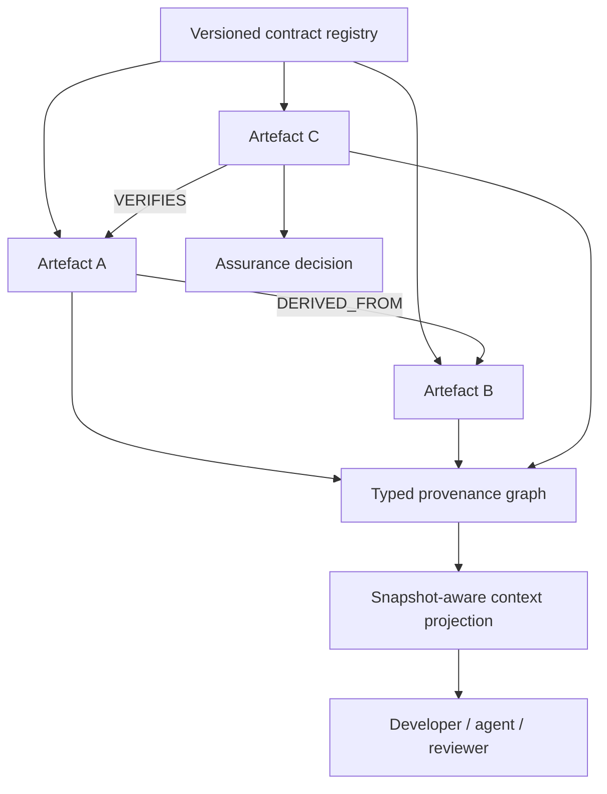
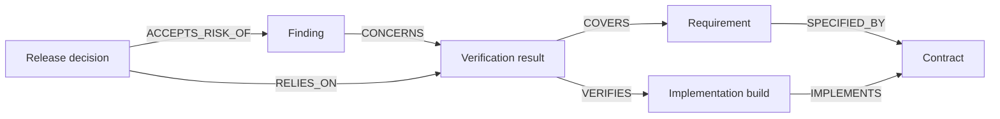

# Engineering Excellence in Agentic Software Development

**Status:** Foundational architecture proposal  
**Version:** 0.1.0  
**Date:** 2026-10-15

> **Working definition:** The fundamental unit of software development is a **verified change in system behaviour**, not a change in code.

## 1. Executive summary

Frontier coding agents produce software faster than humans can review it line by line. The bottleneck moves from implementation to assurance: demonstrating that software meets intended business outcomes, preserves existing behaviour, remains architecturally coherent, and is safe to release.

This proposal establishes **contract-first, evidence-driven engineering**. A versioned contract defines data structure, semantics, behaviour, relationships and verification. Independent verification tests an exact implementation against that contract. Results become immutable, traceable evidence. Reviewers assess intent, risk and evidence, with targeted code inspection where necessary.

The information architecture is **hybrid**: independently versioned immutable artefacts connected by explicit typed relationships, with task-specific working contexts assembled as disposable projections. The model is implementation-independent and applicable to ordinary software, data pipelines and AI-enabled systems.

Assurance is a reproducible, risk-based claim, not a guarantee of absolute correctness.

## 2. The engineering problem

Traditional workflows assume code is expensive to produce and feasible to review. Agentic development reverses the ratio. A coding agent can rapidly generate large changes, tests, documentation and plausible explanations. None alone proves that the result is correct.

Failure modes include wrong interpretations of requirements, tests mirroring the implementation's errors, local improvements creating regressions, architectural drift, unexamined security boundaries, invalid assumptions, and claims that checks passed without independently executed evidence.

A mature process must answer: What changed in observable behaviour? Which contract authorised it? Which exact build was verified? What tests were executed? Which existing behaviours might be affected? What remains unverified? Who approved the residual risk?

## 3. Core principles

1. **Behaviour over code:** the change unit is an observable outcome, not a diff.
2. **Contract before implementation:** specify boundaries and acceptance criteria before generating code.
3. **Independent authority:** implementation agents cannot silently relax specifications or tests.
4. **Evidence over assertion:** trusted execution results outrank agent narratives.
5. **Immutable history:** corrections and revisions create new records.
6. **Explicit, validated relationships:** provenance must not depend on undocumented inference.
7. **Disposable projections:** working contexts are reconstructed from authoritative records.
8. **Architecture as policy:** enforce critical boundaries automatically.
9. **Risk-based human governance:** preserve targeted review for high-impact changes.
10. **Uncertainty is explicit:** missing evidence never implies success.

## 4. Contract-first development lifecycle



### Behaviour specification

A change request records its purpose, baseline behaviour, desired behaviour, non-goals, acceptance examples, expected failure modes, consumers, non-functional constraints and risk classification. A code diff is evidence of implementation activity, not the specification.

### Independent verification

Acceptance tests derive from approved contracts and curated examples, not from reading the generated implementation and deciding what it ought to do. Implementation-authored unit tests remain useful but cannot be the only assurance.

## 5. The five-dimensional contract

| Dimension | Question | Contents |
|---|---|---|
| Structure | What data is valid? | Fields, types, constraints, cardinality, schemas |
| Semantics | What does the data mean? | Business meaning, units, interpretation, uncertainty |
| Behaviour | What must be true? | Preconditions, postconditions, invariants, failure handling |
| Verification | How is compliance demonstrated? | Executable tests, golden examples, thresholds, evidence |
| Relationships | What may or must be linked? | Edge types, allowed endpoints, cardinality, provenance |

Every contract has a stable identifier, version, lifecycle status, owner, dependency declarations and content digest. A logical contract may consist of multiple files, but the manifest pins the exact content of each.

### 5.1 Structure

Machine-readable schemas such as JSON Schema, OpenAPI or Protocol Buffers define valid representations. The canonical definition should not depend on a particular implementation language. Structural validity is necessary but insufficient: a valid object can be semantically false.

### 5.2 Semantics

Define the meaning of values, units, timezones, identity, missing data, unknown results and ambiguity. Distinguish a failed result from a result that cannot be determined. Definitions must be reviewable independently of code.

### 5.3 Behaviour

Specify stable, individually identifiable obligations: preconditions, postconditions, invariants, permitted state transitions, idempotency, retries, error outcomes and non-functional requirements. Distinguish deterministic obligations from those requiring domain interpretation.

### 5.4 Verification

Associate each obligation with a verification method and executable implementation. Useful techniques include schema checks, deterministic assertions, unit and integration tests, property-based and metamorphic tests, golden datasets, mutation testing, adversarial cases, security analysis, performance tests and failure injection.

For probabilistic components, record repeated trials, distributions, uncertainty and acceptance thresholds. A model's confidence or a verifier's written claim is not proof that a check ran.

### 5.5 Relationships

Typed relationships specify permitted source and target contracts, version compatibility, cardinality, consistency conditions and assertion provenance. Relationships themselves need verification and correction history.

```yaml
relationship:
  id: VERIFIED_BY
  sourceContract: BehaviouralRequirement
  targetContract: VerificationResult
  cardinality: zero_or_more
  constraints:
    - target_references_exact_build
    - target_covers_source_requirement
```

This YAML illustrates intent; the named constraints require a real validator.

## 6. Hybrid artefact architecture

Separate the following concepts:

- **Contract definition:** reusable specification for potentially thousands of instances.
- **Artefact:** independently addressable immutable instance of a contract.
- **Relationship assertion:** typed, attributable connection between exact artefact revisions.
- **Execution:** record of inputs, outputs, producer versions and invocation configuration.
- **Projection:** disposable view assembling a consistent working context.
- **Assurance decision:** release or rejection claim referencing specific evidence.



### 6.1 Universal artefact envelope

```json
{
  "artifactId": "artifact-123",
  "revisionId": "sha256:...",
  "contract": {
    "id": "GenericResult",
    "version": "1.0.0",
    "digest": "sha256:..."
  },
  "executionId": "execution-456",
  "createdAt": "2026-10-15T06:00:00Z",
  "producer": {"id": "component-name", "version": "2.0.0"},
  "payload": {"status": "COMPLETE"}
}
```

A logical artefact identifier can survive corrections; each revision is immutable. Content hashes require an agreed canonical serialisation and precise hash scope. Confidential payloads must not be indiscriminately exposed through graph queries or logs.

### 6.2 Relationships and corrections

Edges refer to exact revisions, have explicit types and provenance, and may be asserted, validated, disputed or retracted. Incorrect relationships are superseded rather than overwritten. A graph is only as trustworthy as its edge assertions.

### 6.3 Projections

The consistent object presented to an agent or developer is a **read model**, not the source of truth. Its metadata should pin the graph snapshot, included artefact revisions, projection definition, filter rules and unresolved references. Different consumers receive different purpose-built projections from the same underlying records.

### 6.4 Consistency

Immutability does not remove concurrency challenges. Define atomic publishing, idempotency, ordering, optimistic concurrency for mutable pointers, referential consistency, duplicate handling and retry semantics. Never silently combine incompatible graph snapshots.

## 7. Contract composition

Individual contracts do not guarantee an end-to-end outcome. Composite workflows require compatible producer and consumer types, cross-stage invariants, permitted transitions, failure paths, version resolution and end-to-end acceptance tests.

Semantic versioning communicates compatibility intent but cannot prove compatibility. Contract tests and migration plans must detect both structural and semantic breaking changes. A change to meaning can break consumers even when JSON remains identical.

## 8. Assurance layers

| Layer | Assurance question | Evidence |
|---|---|---|
| Requirements | Is the intended outcome agreed? | Approved behaviour specification |
| Contract | Are boundaries and semantics explicit? | Versioned contract |
| Implementation | Does the exact build conform? | Build provenance, contract tests |
| Behaviour | Does it produce correct outcomes? | Independent acceptance evidence |
| Architecture | Are system boundaries preserved? | Dependency and policy checks |
| Operations | Is it safe and reliable? | Security, resilience and performance checks |
| Regression | Is existing behaviour preserved? | Impact analysis and regression results |
| Governance | Is release justified? | Attributable decision and risk acceptance |

No single layer substitutes for the others.

## 9. Agent roles and trust boundaries

**Specification authority** owns requirements, contract versions and acceptance thresholds. **Implementation agents** produce code and local tests within those constraints. **Independent verification agents** derive challenges from the approved contract, rather than the implementation's interpretation. A **trusted runner** executes tests against exact builds and records machine-produced evidence. **Human decision-makers** own consequential design choices, policy exceptions and risk acceptance.

Independence is not automatically achieved by using two agents: shared models, prompts and assumptions can create correlated errors. Independent oracles, curated examples and expert challenge remain important.

Use least privilege. Coding agents should not be able to silently modify golden answers, disable CI, weaken security policies, rewrite acceptance tests or promote unverified releases. Treat source files, issue text and tool responses as potentially untrusted prompt-injection surfaces.

## 10. Test strategy

Build a balanced portfolio of structural validation, contract tests, unit tests, integration tests, property-based tests, metamorphic tests, curated golden cases, mutation tests, architecture checks, security checks, concurrency and resilience tests, load tests and end-to-end business acceptance tests.

Test counts and line coverage alone are weak indicators. Measure requirement coverage, meaningful boundary coverage, defect detection, mutation score where applicable, flaky tests and unresolved risk. Passing tests are evidence only for the claims they actually exercise.

## 11. Architecture as executable policy

Examples of enforceable rules:

```yaml
architecturePolicies:
  - id: ARCH-001
    rule: domain_must_not_depend_on_infrastructure
  - id: ARCH-002
    rule: public_contract_change_requires_compatibility_review
  - id: ARCH-003
    rule: privileged_operation_requires_authorisation_boundary
  - id: ARCH-004
    rule: production_promotion_requires_verified_evidence
```

This is a policy sketch, not an implemented policy language. Static analysis, module dependency checks, API compatibility tooling and runtime controls enforce different classes of obligation. Human architecture review still matters for maintainability and complexity.

## 12. Pull requests as assurance packages

Pull requests should remain collaboration and control boundaries, but their principal review surface should be an **assurance package**, not a wall of generated code.

Each package should report: intent; baseline and target behaviour; changed contracts and dependencies; architecture impact; independently executed verification results; regression scope; security and operational effects; unresolved findings; exceptions; and a risk-based decision.

Human reviewers should drill into code for high-risk algorithms, persistence migrations, public APIs, security boundaries, concurrency and other consequential changes. Agent summaries are navigation aids, not authoritative evidence.

## 13. Engineering knowledge and execution graph



This graph can answer: Which requirements lack verification? Which contracts have incompatible implementations? Which test evidence became stale after a dependency change? Which release decision relied on a failing or superseded check?

Live execution events can be linked to the same knowledge model through correlation identifiers and versioned event contracts. The graph visualisation is a projection over authoritative records, not another source of truth.

## 14. Assurance records and promotion gates

An assurance record must identify the exact behavioural change, contract digests, source commit, build digest, dependency state, test and verifier versions, datasets, environment, configuration, observed results, skipped checks, unresolved findings, policy and decision-maker.

Illustrative release gate:

```text
Schema and relationship validation    PASS
Deterministic obligations             PASS
Required behavioural scenarios        PASS
Regression policy                     PASS
Architecture policy                   PASS
Security policy                       PASS
Critical unresolved findings          ZERO
Residual risk                          ACCEPTED
```

These checks are risk-specific. A skipped, failed or unexecuted test cannot be reported as passed. A previous build's evidence cannot automatically justify a changed candidate.

## 15. Evidence invalidation and impact analysis

Changes to code, contracts, dependencies, prompts, configuration, test logic or datasets may invalidate previous assurance claims. Traverse the dependency graph to identify affected requirements, consumers and checks. Mark evidence as current, stale, superseded or invalid with an explicit reason.

A semantic change can invalidate evidence even when the data schema does not change. A changed test oracle may require historical results to be rerun or reinterpreted.

## 16. Suggested logical components

| Component | Responsibility |
|---|---|
| Contract registry | Versioned specifications and compatibility |
| Artefact store | Immutable payloads and provenance |
| Relationship registry | Typed assertions, validation and retractions |
| Execution ledger | Invocations, events and state transitions |
| Projection service | Snapshot-consistent working contexts |
| Verification runner | Trusted execution of checks |
| Assurance engine | Policy evaluation and release evidence |
| Impact analyser | Downstream dependencies and stale evidence |
| Review interface | Intent, risk, evidence and drill-down |
| Visualisation | Knowledge and live execution graph |

These are logical responsibilities, not necessarily separate services. A relational database plus object storage may suffice initially; introduce specialised graph technology only if query patterns justify it.

## 17. Reference repository layout

```text
contracts/
  <contract-id>/
    <version>/
      manifest.yaml
      schema.json
      semantics.md
      invariants.yaml
      relationships.yaml
      verification.yaml
      examples/
        valid.json
        invalid.json
engineering/
  policies/
  architecture-rules/
  assurance-templates/
  decisions/
```

The manifest pins file hashes and dependencies. Each verification identifier must resolve to an actual executable check; a declarative label alone is not a test.

## 18. Incremental implementation roadmap

**Phase 0 — Baseline.** Measure existing delivery speed, escaped defects, regression rates, review effort and architectural pain. Choose one bounded pilot.

**Phase 1 — Contract-first pilot.** Write one approved behavioural contract, invariants, examples and independent tests before agent implementation. Assess whether reviewers can evaluate correctness without reading the entire codebase.

**Phase 2 — Immutable evidence.** Persist contract versions, build identities, verification results and assurance decisions. Make release claims reproducible.

**Phase 3 — Typed graph and projections.** Introduce artefact envelopes, relationship validation and snapshot-aware context assembly, initially with the simplest suitable storage.

**Phase 4 — Automated gates.** Enforce architecture, security, compatibility, regression and risk policies. Prevent silent weakening of acceptance criteria.

**Phase 5 — Graph-based assurance.** Add impact analysis, evidence invalidation and visualisation of engineering knowledge and live execution.

Each phase should be evaluated for assurance gained versus operational complexity introduced.

## 19. Success measures

Track escaped defect severity, regression frequency, mean recovery time, percentage of critical requirements with independent evidence, reproducible release claims, breaking changes caught before release, architectural violations, review time spent on material risks, and lead time without quality deterioration. Beware of optimising proxy metrics such as test count or generated lines.

## 20. Open design questions

1. What language-independent format best captures semantic and behavioural obligations?
2. Which invariants should be declarative, and which require executable code?
3. How should composite contracts express end-to-end guarantees?
4. What is genuine verifier independence when agents share a model family?
5. How should probabilistic outputs be accepted and monitored?
6. What consistency model is needed for projections and graph snapshots?
7. How should edge assertions be trusted, challenged and retracted?
8. How should compatibility be assessed for semantic changes without schema changes?
9. How should evidence invalidation propagate through the graph?
10. Which gates should vary with the risk classification of a change?

## 21. Decisions and hypotheses

**Working principles:** verified behavioural change is the engineering unit; development is contract-first and evidence-driven; contracts have five dimensions; immutable artefacts are linked through explicit typed relationships; projections are disposable; specification, implementation, verification and promotion authority are separated; pull requests become risk-focused assurance packages.

**Hypotheses to validate:** the contract and artefact graph could become the primary engineering knowledge model; relational storage may suffice initially; contract composition and evidence invalidation are the next critical design areas; live graph visualisation may improve human oversight.

## 22. Closing position

Agentic software development should not depend on humans manually reading every generated line. It should make behaviour explicit, constrain implementations through approved contracts, independently execute verification, preserve evidence and keep release decisions accountable.

> **Engineering excellence is the ability to explain, demonstrate and reproduce why a particular change in system behaviour is acceptable.**
