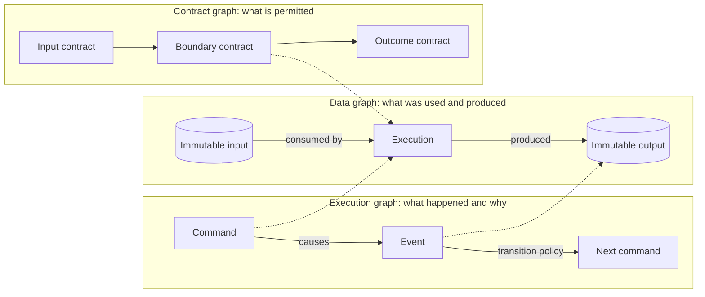
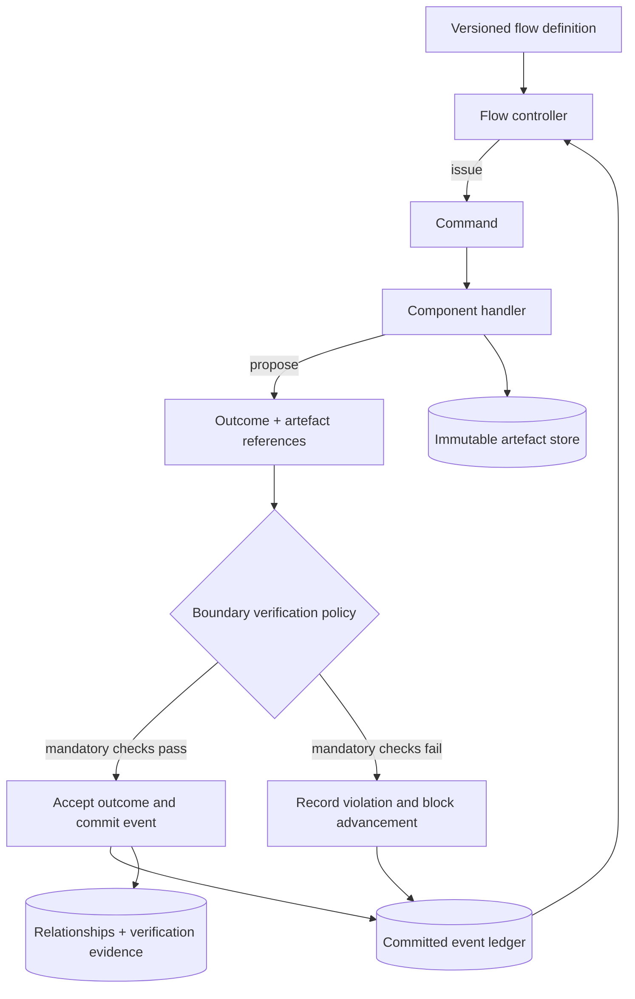
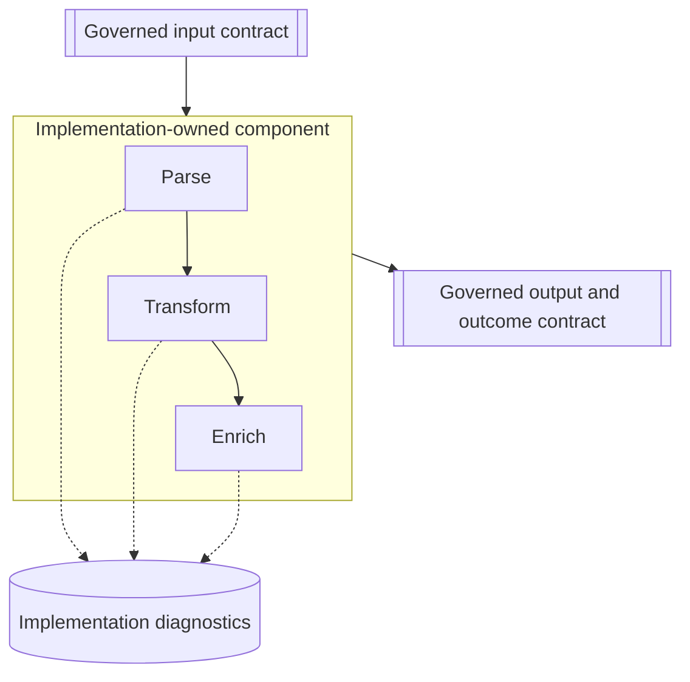
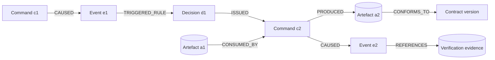
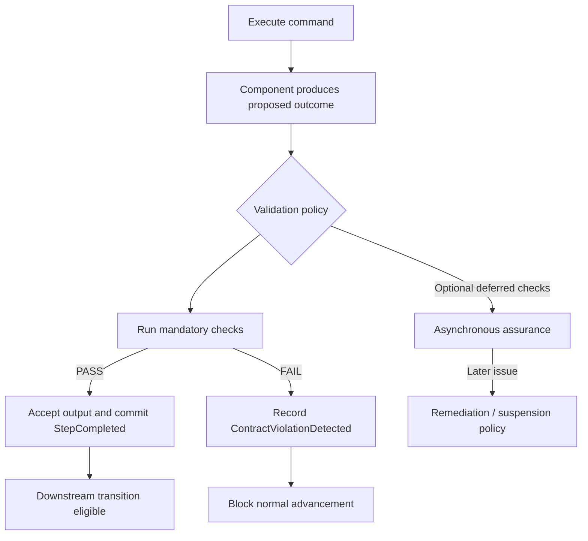
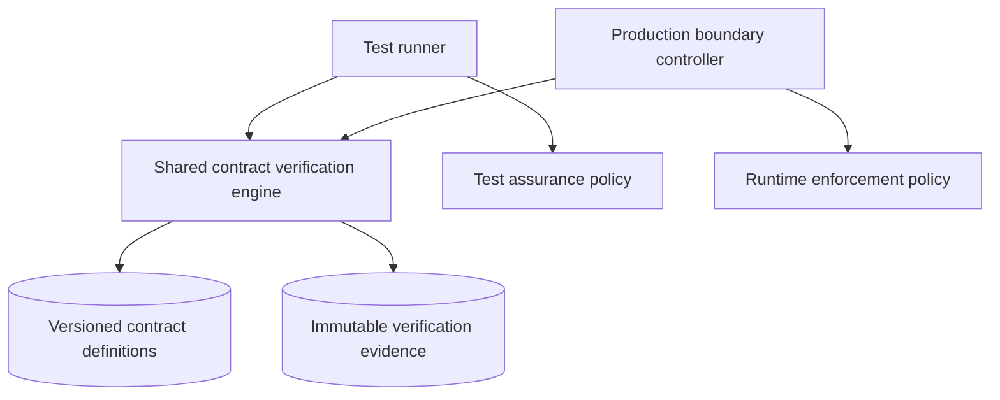

# Event-Driven Engineering Flow

**Status:** Working architecture proposal  
**Version:** 0.1  
**Scope:** Generic software engineering architecture; no application-specific implementation assumptions.

## Executive summary

The objective is to make an application's **engineering flow a first-class, inspectable and controllable system**. Engineers should be able to understand, critique, test and improve processing at meaningful boundaries without reading low-level implementation code. Commands express intent; events record occurrences and drive subsequent actions; immutable artefacts preserve information; explicit typed relationships establish causality, lineage and dependencies; versioned contracts define what components promise.

The central design principle is **govern meaningful boundaries, not every operation**. Architecture defines a manageable set of observable, testable and repeatable boundaries. Implementers remain free to choose internal decomposition, including lower-level contracts and diagnostics. Testing and production enforcement reuse the same contract semantics, with risk-appropriate validation policies.

> **Working proposition:** The unit of engineering review is a verified change in observable system behaviour, expressed through governed contracts and supported by immutable execution evidence—not a change in code.

## 1. Goals and non-goals

### Goals

- **Readability:** Inspect the intended processing flow, its decisions and outcomes without tracing Java methods or service calls.
- **Control through events:** Meaningful events trigger explicit, versioned transition rules that issue commands.
- **Reconstruction:** Recreate the observed execution path, including why each command was issued and which artefacts it consumed or produced.
- **Immutability:** Retain durable records of artefacts, events, commands, verification and decisions; changes create new versions or records.
- **Compositional testing:** Test a component, a connected section or an entire flow using the same contract-verification model.
- **Architectural economy:** Spend architecture-review effort on boundaries that matter, not implementation minutiae.
- **Independent assurance:** Verify observable obligations without relying on the implementation's assertion that it is correct.

### Non-goals

- Prescribing a contract for every method, parser or field transformation.
- Requiring every internal action to be a durable domain event.
- Assuming nondeterministic implementations must produce byte-for-byte identical outputs.
- Assuming immutable inputs alone guarantee deterministic replay.
- Mandating a graph database, microservices or a particular language/framework.

## 2. Three connected graphs

The system can be understood as three logically distinct but linked graphs.



**Execution graph.** Commands, events, decision records and their causal relationships explain progression.  
**Data graph.** Immutable artefacts and transformations explain information provenance.  
**Contract graph.** Versioned definitions describe permitted inputs, outputs, outcomes, invariants and relationships.

The graphs share stable identifiers but serve different purposes. A flow diagram derived from source code shows what **could** happen; an execution ledger shows what **did** happen.

## 3. Core entities and meanings

| Entity | Meaning | Example |
|---|---|---|
| **Command** | An explicit request to perform work; it may be accepted or rejected | `AnalyseContent` |
| **Event** | A recorded fact that something happened | `AnalysisCompleted` |
| **Artefact** | An immutable information object, typically referenced rather than embedded in events | `AnalysisResult@v3` |
| **Contract** | A versioned specification of externally observable obligations | `AnalysisResultContract@1.0` |
| **Relationship** | An explicit, typed assertion between identified entities | `CONSUMED`, `PRODUCED`, `CAUSED_BY` |
| **Flow definition** | Versioned transitions, guards, policies and permitted routes | `DocumentFlow@2.1` |
| **Flow execution** | One observed run of a particular flow version | `flow-run-203` |
| **Step definition** | A meaningful unit of engineering responsibility and its boundary | `Analyse@1.0` |
| **Step execution / attempt** | A particular invocation and retry attempt | `execution-52`, `attempt-2` |
| **Verification evidence** | Recorded outcome of applying specific checks to exact artefacts | `verification-789` |

**A command expresses intent; an event records an occurrence; an artefact holds information.** One command can be rejected, retried or produce several events. A successful technical execution can still yield a negative business outcome; a technical failure is not the same as an adverse business result.

## 4. Control through events, not merely event-shaped logging

A system is not genuinely event-controlled merely because it logs events after executing a hard-coded call chain. The flow controller must evaluate observed events against an explicit definition and issue subsequent commands accordingly.



The controller owns **which step follows**; a component owns **how its declared responsibility is performed**. The runtime should record the decision that led to a command, including the rule and inputs considered. Otherwise, an observer may know *that* a command was issued without knowing *why*.

### Illustrative flow definition

```yaml
flowId: GenericProcessing
version: 1.0
transitions:
  - id: after-analysis-success
    on: AnalysisCompleted
    when: outcome.status == "SUCCESS"
    issue: ValidateAnalysis
  - id: after-validation-pass
    on: ValidationCompleted
    when: outcome.status == "PASS"
    issue: PublishResult
  - id: after-validation-fail
    on: ValidationCompleted
    when: outcome.status == "FAIL"
    issue: RequestCorrection
  - id: on-contract-violation
    on: ContractViolationDetected
    issue: InvestigateFailure
```

This is illustrative syntax, not a selected workflow-engine product or a complete treatment of concurrency, retries or compensation.

## 5. Contract granularity: the architect's scarce resource

**Do not define every internal operation as an architect-governed step.** A contract at `ParseField` level can be just as burdensome to review as a large generated pull request. The architecture should expose *meaningful boundaries* and let implementers decompose internally.



The diagram's internal operations are examples, not a prescription for required lower-level contracts.

### Two levels of authority

| Concern | Governed contract | Implementation contract |
|---|---|---|
| Defined by | Architecture / designated engineering authority | Implementer |
| Describes | Meaningful cross-component obligation | Internal decomposition and correctness |
| Reviewed for | Observable behaviour, compatibility, risk, evidence | Local correctness and maintainability |
| Visibility | Always in engineering flow | Available on drill-down as useful |
| Approval | According to governance policy | Normally implementation-owned |

### Heuristics for placing a governed boundary

A boundary is a candidate for governance when its outcome:

1. Is independently meaningful to the wider flow.
2. Is needed to restart or repeat processing from a known checkpoint.
3. Can be independently verified or compared.
4. Transfers responsibility between components or teams.
5. Influences a consequential branch, approval or publication decision.
6. Represents a material risk, external side effect or compliance obligation.

Not every candidate must satisfy every criterion. **Choosing the right granularity is a core architectural skill**, to be refined through actual engineering experience rather than fixed prematurely.

## 6. What is a processing step?

A **processing step** is an independently identifiable unit of engineering responsibility that accepts a command, uses explicitly referenced inputs and produces observable outcomes under a defined boundary contract. It is **not** necessarily a Java class, function, service or LLM call.

Its external definition may specify:

- Identity and version.
- Accepted command and input artefact contracts.
- Permitted output artefacts and outcome events.
- Required behavioural invariants and verification obligations.
- Execution constraints, such as timeout, retry, cancellation and idempotency.
- Relationships and evidence that must be recorded.

Its implementation may contain any number of internal operations. A step can be atomic at its governed boundary while internally complex. Composite steps or named subflows are possible, but their exact hierarchy and whether they have independent lifecycle semantics remain open decisions.

### Illustrative step contract

```json
{
  "stepId": "AssessQuality",
  "version": "1.0",
  "description": "Assess the quality of an input artefact",
  "command": "AssessQuality",
  "inputs": [
    { "name": "subject", "contract": "AnalysisResult@1.0", "required": true }
  ],
  "outputs": [
    { "name": "assessment", "contract": "QualityAssessment@1.0" }
  ],
  "outcomes": [
    "QualityAssessmentCompleted",
    "QualityAssessmentFailed"
  ],
  "execution": {
    "timeoutSeconds": 120,
    "maxAttempts": 3,
    "idempotencyRequired": true
  }
}
```

## 7. Immutability, relationships and reconstructability

Immutable artefacts avoid ambiguous overwrites. Commands, events, decisions and verification records should also be append-only in the logical history; corrections and supersessions create new records. Explicit links make provenance traversable.



### Illustrative event envelope

```json
{
  "id": "event-203",
  "type": "ValidationCompleted",
  "flowId": "flow-100",
  "correlationId": "corr-100",
  "causationId": "command-202",
  "executionId": "execution-52",
  "attemptId": "attempt-1",
  "flowDefinitionRef": "GenericProcessing@1.0",
  "contractRef": "ValidationCompleted@1.0",
  "artifactRefs": {
    "inputs": ["document-17@v1"],
    "outputs": ["validation-result-33@v1"]
  },
  "occurredAt": "2026-10-18T09:00:00Z"
}
```

### Illustrative typed relationship

```json
{
  "id": "relationship-900",
  "type": "PRODUCED",
  "from": { "kind": "STEP_EXECUTION", "id": "execution-52" },
  "to": { "kind": "ARTIFACT", "id": "validation-result-33@v1" },
  "assertedAt": "2026-10-18T09:00:01Z",
  "sourceEventId": "event-203"
}
```

### Graph extract for inspection

```json
{
  "nodes": [
    { "id": "c1", "kind": "COMMAND", "type": "ProcessDocument" },
    { "id": "e1", "kind": "EVENT", "type": "ProcessingStarted" },
    { "id": "a1", "kind": "ARTIFACT", "type": "DocumentContent" },
    { "id": "c2", "kind": "COMMAND", "type": "ValidateDocument" },
    { "id": "a2", "kind": "ARTIFACT", "type": "ValidationResult" },
    { "id": "e2", "kind": "EVENT", "type": "ValidationCompleted" }
  ],
  "edges": [
    { "from": "c1", "to": "e1", "type": "CAUSED" },
    { "from": "e1", "to": "a1", "type": "PRODUCED" },
    { "from": "a1", "to": "c2", "type": "CONSUMED_BY" },
    { "from": "c2", "to": "a2", "type": "PRODUCED" },
    { "from": "c2", "to": "e2", "type": "CAUSED" },
    { "from": "e2", "to": "a2", "type": "REPORTS" }
  ]
}
```

The graph extract is a **projection** of underlying records. Its edges must be grounded in actual source relationships; they should not be invented solely to make a diagram attractive.

### Does reconstruction come for free?

**Largely, if the control plane records the right evidence.** A faithful reconstruction requires: durable history, causal links, immutable input/output references, exact flow and contract versions, and recorded transition decisions. A timestamp-ordered list alone is not sufficient, particularly with concurrency.

Reconstructing the *observed path* is not the same as reproducing the *same result*. Replay may also require implementation/configuration versions, external response snapshots, model versions, random seeds and side-effect handling. Recovery needs explicit idempotency and checkpoint policy.

## 8. Failure semantics and diagnostic depth

Suppose a component internally executes `Parse → Transform → Enrich`. A parser failure need not become a new architect-governed `ParseFailed` contract. The component can report a governed technical failure while retaining detailed diagnostics separately.

```json
{
  "eventType": "ComponentFailed",
  "component": "InformationProcessor",
  "executionId": "execution-123",
  "status": "TECHNICAL_ISSUE",
  "errorRef": "diagnostic-456"
}
```

Distinguish:

- **Business-negative outcome:** Work executed successfully and concluded that the business condition failed.
- **Technical failure:** Work could not satisfy its technical obligations.
- **Contract violation:** Proposed output failed mandatory contract checks.
- **Verification unavailable:** Required verification could not be completed.
- **Unknown outcome:** An external side effect may have occurred but cannot yet be confirmed.

The governed flow remains simple while the **observability hierarchy can be much deeper than the contract hierarchy**. Domain events, execution lifecycle records and low-level telemetry should be linked but need not share retention or durability policies.

## 9. Testing by contract and by graph section

A governed contract provides a natural verification boundary. Because components can be composed, the same verifier can be used for component, selected-section and full-flow tests.


*Illustration: test the selected `Extract → Analyse → Validate` section using a known immutable input at the section entrance and verify intermediate and terminal obligations.*

| Scope | Test objective | Evidence |
|---|---|---|
| Component | Verify one component's input/output/outcome obligations | Contract checks, exact artefact references |
| Section | Verify a connected subset, including hand-offs | Boundary checks, causal events, intermediate artefacts |
| Full flow | Verify complete routes, branches, failure handling and final outcomes | End-to-end graph, flow-version and decision trace |

Graph dependencies can inform regression selection and change-impact analysis, provided dependency capture is sufficiently complete. Critical tests should not be excluded solely because the graph appears not to show a dependency.

### Deterministic contracts for nondeterministic components

An LLM or other nondeterministic component can produce variable outputs while satisfying deterministic properties. Examples include schema validity, enumerated classifications, reference integrity, numeric bounds and formally specified invariants. **The verdict for a deterministic predicate can be deterministic even if the output is not.**

Semantic accuracy, usefulness and subjective quality may require reference cases, independent evaluators, human review or statistical acceptance criteria. A model judge emitting `PASS`/`FAIL` is not automatically a deterministic verifier.

### Illustrative test record

```json
{
  "testExecutionId": "test-204",
  "scope": { "from": "Extract", "to": "Validate" },
  "flowDefinitionRef": "GenericProcessing@2.1",
  "inputArtifacts": ["source-101@v1"],
  "componentVersions": {
    "Extract": "1.4.0",
    "Analyse": "2.2.0",
    "Validate": "1.3.0"
  },
  "result": "PASS",
  "verifiedContracts": [
    "ExtractionResult@1.0",
    "AnalysisResult@2.0",
    "ValidationResult@1.0"
  ],
  "evidenceRefs": ["verification-901", "verification-902"]
}
```

## 10. Runtime validation: assurance versus enforcement

A governed boundary can also be a runtime verification point. **Not every boundary should incur full verification cost on every invocation.** Each boundary has a versioned policy defining required checks, timing, failure behaviour and evidence.



### Suggested verification depths

| Depth | Examples | Expected cost |
|---|---|---|
| Basic | JSON schema, required fields, types, permitted outcome codes | Often low |
| Standard | Basic checks plus referential integrity, business invariants, consistency | Variable |
| Enhanced | Standard plus external corroboration or expensive semantic evaluation | Potentially high |

These are conceptual tiers, not fixed policy values. The architect defines **required assurance**; implementation and platform engineering choose efficient enforcement mechanisms.

### Is successful validation another event?

**Not necessarily.** Distinguish the verification record from the event that changes workflow state.

| Verification outcome | Immutable evidence | Flow event |
|---|---|---|
| Pass | Checks, policy version, result, input/output refs | Usually `StepCompleted`, referencing verification evidence |
| Fail | Failed predicates, diagnostics | `ContractViolationDetected`; block normal continuation |
| Unavailable | Cause and attempted checks | `VerificationUnavailable` or technical failure |
| Skipped by explicit policy | Policy and reason | Normal outcome may proceed, with status visible |

Successful verification need not generate a separate `ContractValidated` workflow event unless downstream policy explicitly depends on that event. This avoids cluttering the engineering graph with mechanically redundant nodes.

### Accepted completion event

```json
{
  "eventType": "StepCompleted",
  "executionId": "exec-123",
  "outputArtifactRef": "artifact-456",
  "verification": {
    "status": "PASS",
    "policyRef": "BoundaryPolicy@2.0",
    "evidenceRef": "verification-789"
  }
}
```

### Verification evidence

```json
{
  "verificationId": "verification-789",
  "boundary": "AnalyseToValidate",
  "policyRef": "BoundaryPolicy@2.0",
  "status": "PASS",
  "checksExecuted": 8,
  "durationMs": 12,
  "inputArtifactRefs": ["artifact-456"],
  "evidenceRef": "evidence-789"
}
```

*The duration above is illustrative, not a benchmark.*

### Performance and consistency

- Measure verification latency and cost per boundary; optimise using evidence rather than assumption.
- Prefer validating stable references, metadata and hashes where sufficient rather than repeatedly loading large artefacts.
- Cache only when exact artefact content, verifier version, policy and relevant dependencies match.
- Run expensive assurance asynchronously only where the risk policy permits subsequent remediation; it cannot retroactively prevent downstream work already performed.
- For mandatory checks, **acceptance of the verified outcome and durable publication of the event must be coordinated reliably**, e.g. through a transaction and outbox pattern or an equivalent design.
- Distinguish command acceptance, attempt start, completion, retry, cancellation and unknown external side-effect outcome.

## 11. Testing and production share verification semantics



The **definitions and verification implementations** should be shared. Policies may differ: tests may run exhaustive expensive checks; production may run mandatory cheap checks and schedule additional assurance. A production pass therefore establishes only the guarantees actually enforced under that policy.

## 12. Engineering inspection and review experience

An engineering interface should support at least two linked views:

1. **Definition view:** All permitted routes, transitions, governed boundaries, contracts, verification obligations and failure paths.
2. **Execution view:** Actual commands, events, decisions, artefacts, validation outcomes, timing, retries and diagnostics for one run.

The same source definitions that govern execution should generate the design view; the observed execution ledger should generate the run view. Engineers should be able to drill down into implementation-owned diagnostics when needed without forcing that detail into the architect's default review surface.

Useful review questions include: What caused this command? Which transition rule was satisfied? What exact inputs were consumed? Which contract version applied? Was the output verified? Where could execution resume? Which downstream contracts are affected by a proposed change?

## 13. Engineering responsibilities

| Role | Primary responsibility |
|---|---|
| Architect / engineering authority | Select meaningful governed boundaries; approve externally significant contracts, transitions and risk policies |
| Implementer / coding agent | Implement components; choose internal decomposition; maintain local tests and diagnostics |
| Flow runtime | Apply transition rules; manage commands and event progression; preserve causality |
| Verification framework | Evaluate contract obligations independently and produce immutable evidence |
| Reviewer | Evaluate intended behavioural change, risk, compatibility and verification evidence rather than every line of code |

This division is intended to **protect architect time**, not remove engineering judgement. The right level of contract definition remains a key skill.

## 14. Logical platform capabilities

The architecture implies capabilities rather than a prescribed deployment topology:

- **Flow-definition registry:** Versioned transitions, guards and policies.
- **Contract registry:** Governed schemas, invariants and compatibility rules.
- **Command execution service:** Routing, attempt identity, idempotency and execution constraints.
- **Event ledger:** Durable occurrence records and causal metadata.
- **Artefact store:** Immutable, versioned data with stable references.
- **Relationship registry / graph projection:** Typed links and traversable provenance.
- **Verification engine:** Shared deterministic checks, plus optional independent evaluators.
- **Assurance evidence store:** Check results, policy versions, exact tested inputs and build versions.
- **Inspection UI:** Definition-versus-execution visualisations and diagnostic drill-down.

These may be implemented within a modular monolith, across services, or through a hybrid deployment. An explicit graph representation does **not** automatically require a graph database.

## 15. Open architectural decisions

1. **Contract boundary selection:** What practical criteria justify promoting an implementation boundary to a governed boundary?
2. **Composition:** When is a composite step a real executable unit, versus merely a named grouping in a flow definition?
3. **Verification location:** Central verification service, shared embedded library, or hybrid—with what independent trust guarantees?
4. **Validation policy:** Which checks are mandatory before progression, which are deferred, and which are test-only?
5. **Replay:** What levels of repeatability are promised: path reconstruction, re-execution, deterministic replay or recovery?
6. **Relationship model:** Which edge types are canonical and how are assertions corrected or superseded?
7. **Concurrency:** How are joins, competing events, ordering and multi-event decisions expressed?
8. **Side effects:** How are exactly-once *business effects*, compensation and uncertain external outcomes handled without assuming exactly-once messaging?
9. **Observability:** Which internal diagnostics are retained, sampled or promoted into durable execution evidence?
10. **Review and evolution:** How do contract compatibility, migration and evidence invalidation work across versions?

## 16. Working architectural principles

1. **Flow is executable architecture:** Explicit definitions govern transitions; events are more than logging.
2. **Govern meaningful boundaries:** Architect-approved contracts are sparse, purposeful and reviewable.
3. **Implementation freedom:** Lower-level contracts and processing decomposition are owned by implementers unless elevated for a clear reason.
4. **Immutable evidence:** Commands, events, artefacts, decisions and verification outcomes form a traceable history.
5. **Explicit causality:** Record why work happened, not just its order.
6. **Compositional assurance:** The same contract model supports component, section and full-flow testing.
7. **Deterministic obligations, not necessarily deterministic outputs:** Verify objective properties of nondeterministic components; treat semantic judgement separately.
8. **Policy-based runtime enforcement:** Mandatory checks gate progression; optional checks are proportional to risk and cost.
9. **Verification evidence is not automatically a workflow event:** Publish events when they convey meaningful outcomes or change control flow.
10. **Inspection depth exceeds governance depth:** Engineers can investigate internals without architects defining every internal operation.

## Conclusion

The target is not a graphical representation of existing code. It is a system in which **meaningful processing boundaries, event-driven transitions, immutable information and executable contracts form the application's engineering model**. Engineers can critique that model, test any connected section, inspect the evidence from real runs and improve behaviour without starting from low-level implementation details.

The next design effort should concentrate on boundary-selection heuristics, verification-engine placement and the exact event/decision/artefact relationship model—without prematurely prescribing fine-grained step composition.
