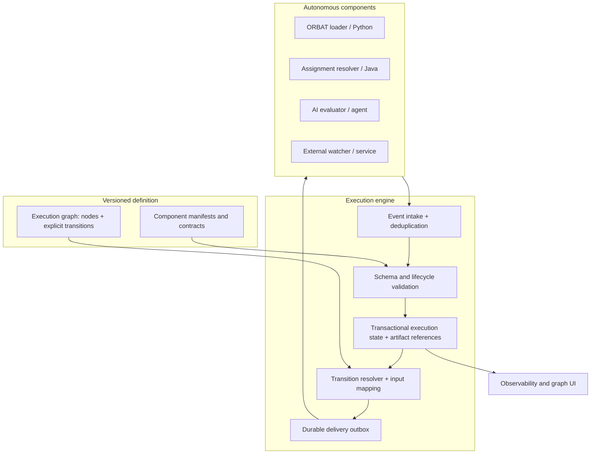
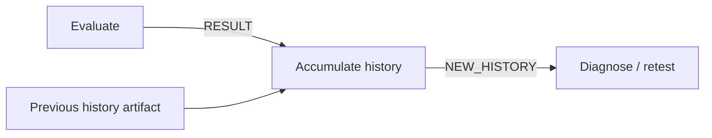
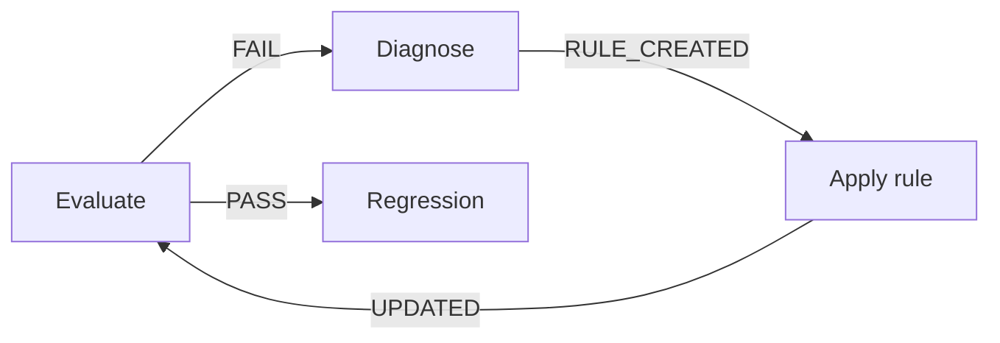
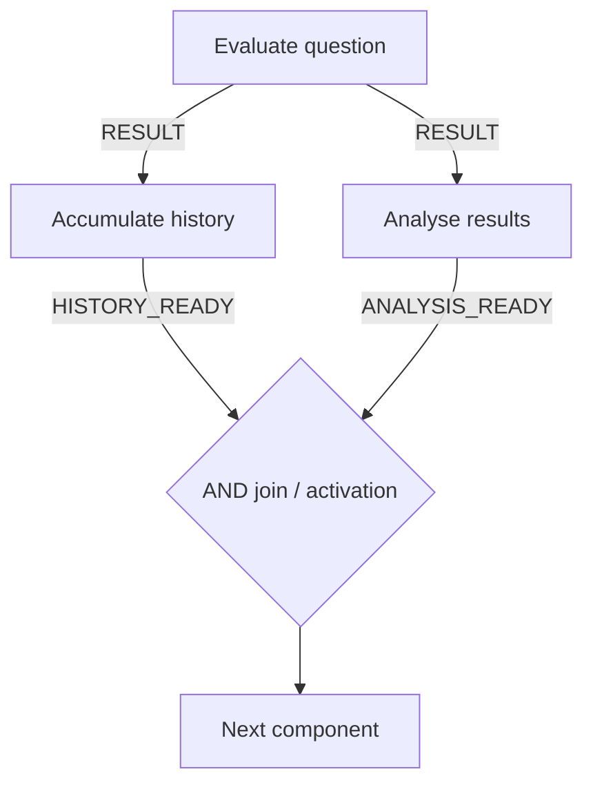
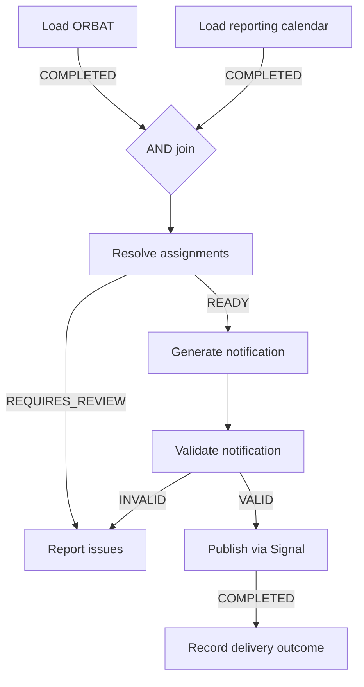
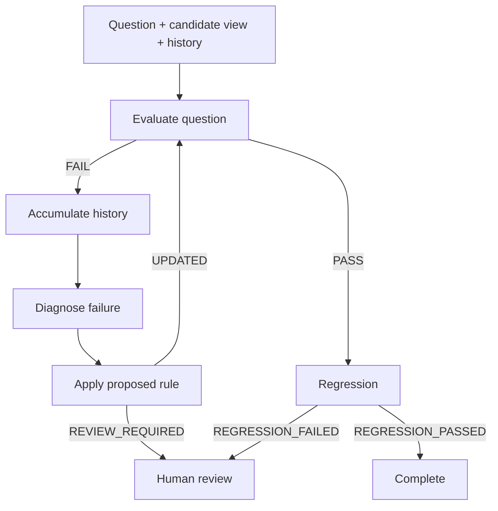

# Governed Execution Graph — Architecture Specification v0.1

**Status:** Architecture baseline for implementation planning  
**Date:** 27 October 2026  
**Audience:** Architects, component authors, runtime developers, development agents  
**First proof:** HQ Company reporting notifications (ORBAT, reporting calendar, Signal)  
**Second reference case:** Semantic-view evaluation, diagnosis and regression framework

> **Central principle:** Components govern behaviour. The graph governs permitted connectivity and data movement. The engine governs contract validation, consistent execution state, event processing and reliable message delivery.

## 1. Purpose and scope

Build a **language-independent, event-driven, contract-governed execution framework** whose authoritative model is a versioned graph of components and explicit transitions. Components may be written in Java, Python, JavaScript, implemented as AI agents, or hosted as external services. The runtime does not need domain-specific knowledge of ORBATs, reporting calendars, semantic views, evaluation questions or chat approvals.

This is a **design baseline**, not a claim that all runtime edge cases have been solved. Illustrative YAML and JSON are proposed schema shapes, not a frozen wire protocol. The first implementation can be a small Java/Spring application without making the component model Java-specific.

### Goals

- Make the graph the authoritative definition of governed execution and permitted data movement.
- Make component invocations independently testable, inspectable and replayable from declared business inputs.
- Validate versioned contracts at boundaries, including event payloads and mapped destination inputs.
- Support ordinary sequential execution, fan-out, AND joins, graph cycles, asynchronous components and concurrent runs.
- Capture enough immutable artifacts and execution history to explain *what ran, what it consumed, what it produced, and which transition was selected*.
- Keep business behaviour, timing, retries, polling, approval waiting and shared-resource conflict handling inside components.
- Permit intermediate status and heartbeat events without requiring transitions.
- Support a future live knowledge/execution graph UI without making visualisation part of the runtime's business logic.

### Non-goals

- A universal business-rule engine or semantic interpreter.
- A central scheduler that decides polling cadence, component timeouts or business retry policy.
- An assumption that every component is a Java class, a synchronous function or a microservice.
- Exactly-once execution of arbitrary external side effects.
- Automatic business-history accumulation, implicit dependencies, or inferred transitions.
- Mandatory Kafka, distributed infrastructure, or a graph database in the MVP.

## 2. Confirmed architecture decisions

| Area | Decision | Consequence |
|---|---|---|
| Runtime | Language-independent contracts and graph | Any compliant component implementation can participate |
| Component autonomy | Components own internal execution, timing, polling, waiting, retries and external interactions | Engine does not supervise business process timing |
| Invocation state | Stateless **business** invocations | Each invocation receives all output-affecting business inputs explicitly |
| Operational state | Components may retain internal operational state | It must not silently replace declared business dependencies |
| Data exchange | Engine-mediated, explicit mappings | Governed components do not directly invoke other governed components |
| Artifacts | Immutable, versioned references | Earlier outputs remain available for audit and replay |
| Business history | Explicitly accumulated by components | Engine never invents or automatically gathers business context |
| Events | All engine-consumable event types declared in component manifest | Intermediate events and terminal events share an interoperable envelope |
| Transitions | Explicit, first-class graph edges | No transition inferred from matching input/output schemas |
| Routing | Engine matches declared event/outcome against graph edges | Engine does not interpret business meaning |
| No transition | Legitimate for declared update/terminal events; unexpected unmatched events are errors | Observability need not advance execution |
| Fan-out | One event can select multiple outgoing transitions | Independent downstream activations may proceed concurrently |
| Joins | AND join for explicitly required inputs | Destination runs only when the correct activation has all required inputs |
| Cycles | Ordinary explicit backward/self edges | No special loop controller or loop scope required |
| Concurrency | Supported, with correlated activations and atomic engine state updates | Independent execution can finish in any order |
| Shared-resource conflicts | Component responsibility | Optimistic locking/version checks etc. belong to domain logic |
| Correlation | Component-defined business correlation + engine activation IDs | Engine treats business correlation values as opaque |
| Delivery | Durable at-least-once delivery and idempotency | No promise of exactly-once external effects |
| Component registration | Versioned, language-independent manifests | Preflight graph/contract validation is possible |
| Event retention | Business-case-specific policy | Preserve minimum recovery state separately from optional observability history |
| Engine authority | Validate, record, match, route, correlate and deliver | No invented ordering, retries, timeout or business decisions |

## 3. Conceptual architecture



The diagram depicts **logical responsibilities**, not necessarily distinct deployed services. A local MVP may combine engine, components and persistence in one process. All governed messages still pass through the logical engine boundary.

### 3.1 Vocabulary

- **Graph definition:** immutable versioned specification of component nodes, transitions, conditions, input mappings and join requirements.
- **Component manifest:** versioned declaration of inputs, emitted event types, payload schemas, lifecycle effects and invocation adapter.
- **Run:** one execution instance pinned to a graph version and compatible manifest versions.
- **Node:** a named occurrence of a component within a graph; a component implementation may appear in multiple nodes.
- **Invocation:** one attempt to perform a node's business function with a specific, immutable input set; a node can be invoked repeatedly in one run.
- **Event:** a declared component communication (e.g. `HEARTBEAT`, `FILE_RECEIVED`, `COMPLETED`, `FAILED`).
- **Artifact:** immutable business data output, referenced by identifier, content type and schema version.
- **Transition:** an explicit edge matching a declared event/outcome, optionally mapping its data to a destination.
- **Activation:** engine-managed identity for one intended destination invocation, including its pending incoming inputs.
- **Business correlation:** opaque key provided through component-defined context to group logically related work.
- **Delivery:** governed invocation message handed to an adapter; redelivery is possible.

## 4. Component contracts and registration

A component's public contract is **data and protocol**, not a language-specific interface. The manifest declares the input schema, all event types the engine may receive, payload schemas, lifecycle effects and an adapter binding. Events are not required to have outgoing transitions.

```yaml
component:
  id: orbat-loader
  version: 1.0.0
  input:
    schemaRef: schemas/OrbatLoadRequest/1.0.0
  events:
    HEARTBEAT:
      schemaRef: schemas/Heartbeat/1.0.0
      lifecycle: ACTIVE
    FILE_RECEIVED:
      schemaRef: schemas/FileReceived/1.0.0
      lifecycle: ACTIVE
    COMPLETED:
      schemaRef: schemas/OrbatSnapshot/1.0.0
      lifecycle: TERMINAL
    FAILED:
      schemaRef: schemas/FailureDetails/1.0.0
      lifecycle: TERMINAL
  adapter:
    kind: http # illustrative; in-process or broker adapters also allowed
    endpointRef: orbat-loader-service
```

The manifest may specify transport/adapter information, but **transport is not execution semantics**. Adapters translate function returns, HTTP callbacks or broker messages into the same logical event envelope.

### 4.1 Proposed event envelope

```json
{
  "eventId": "evt-105",
  "runId": "run-001",
  "invocationId": "inv-001",
  "nodeId": "load-orbat",
  "componentVersion": "1.0.0",
  "eventType": "COMPLETED",
  "occurredAt": "2026-10-27T07:15:00Z",
  "businessCorrelation": "reporting-period-2026-11",
  "payloadSchema": "OrbatSnapshot/1.0.0",
  "payload": {"personnelCount": 42, "orbatVersion": "2026-10"}
}
```

`eventId` enables deduplication. `invocationId` binds the event to one specific invocation. The engine validates the event type and schema against the pinned manifest, records the event according to policy, updates invocation lifecycle state and independently evaluates matching graph transitions.

### 4.2 Lifecycle is separate from routing

- `ACTIVE`: the invocation remains outstanding; the event may be recorded and projected into observability state. No outgoing edge is required.
- `TERMINAL`: the invocation has finished for this invocation identity; its terminal output can be persisted and used by transitions. A terminal event with no outgoing edge can legitimately end a branch if allowed by the graph/contract.
- A business outcome such as `NO_REPORT_DUE` or `FILE_NOT_FOUND` is **not automatically a technical failure**.
- Technical failures can have explicit graph transitions when declared; otherwise they prevent normal downstream readiness and are recorded as failure.
- Unknown event types, invalid payloads, conflicting terminal events or unexpected unmatched routable outcomes are governed errors, not silent drops.

**Preflight validation** should verify event names, contract versions, node references, transition selectors, input mapping compatibility, join requirements and legal terminal behaviour. Runtime validation remains necessary because actual values can differ.

## 5. Graph definition and transitions

Every permitted inter-component movement is an explicit edge. The engine never infers an edge because a destination input schema happens to match an upstream output.

```yaml
flow:
  id: reporting-notification
  version: 0.1.0
nodes:
  - id: load-orbat
    component: orbat-loader@1.0.0
  - id: load-calendar
    component: reporting-calendar-loader@1.0.0
  - id: resolve-assignments
    component: assignment-resolver@1.0.0
    join: ALL
  - id: generate-message
    component: message-generator@1.0.0
transitions:
  - id: orbat-to-resolver
    from: load-orbat
    on: COMPLETED
    to: resolve-assignments
    mapping:
      orbat: event.payload
  - id: calendar-to-resolver
    from: load-calendar
    on: COMPLETED
    to: resolve-assignments
    mapping:
      calendar: event.payload
  - id: assignments-ready
    from: resolve-assignments
    on: COMPLETED
    when:
      field: event.payload.outcome
      equals: READY
    to: generate-message
    mapping:
      assignments: event.payload.assignments
```

This YAML is a **candidate representation**. In particular, the exact grammar for event selection, field mapping, optional fields and join groups remains to be formalised before implementation.

### 5.1 Routing semantics

1. Receive a declared event and identify the corresponding run, invocation and pinned node.
2. Validate envelope, payload and lifecycle consistency.
3. Persist required event/artifact state durably.
4. Evaluate **all** outgoing edges whose event selector and conditions match.
5. For each selected edge, record the selected transition and mapped artifact references.
6. Update/create the destination activation, using the correct correlation identity.
7. When the activation's required inputs are satisfied, validate the complete destination input and enqueue one intended invocation.
8. Deliver via an adapter; redelivery is possible and must not create an additional logical invocation.

One event may select **zero, one or multiple** outgoing edges. A valid `HEARTBEAT` with no edge is processed but causes no routing. A `COMPLETED` event may fan out to multiple destinations.

### 5.2 Mapping versus business transformation

The engine may select and bind explicitly declared fields or immutable artifact references. It must not calculate domain-specific meanings, merge business histories, invent defaults or silently fetch unrelated earlier outputs. A dedicated component performs any business transformation or accumulation.

## 6. Stateless business invocations and history

Each invocation receives a complete, declared business input. Operational connections and polling state may be held by a component, but business results must not depend on undeclared state from a previous invocation.

```json
{
  "runId": "eval-run-001",
  "invocationId": "eval-inv-003",
  "nodeId": "evaluate-question",
  "inputs": {
    "question": "artifact-question-001",
    "semanticView": "artifact-view-v3",
    "evaluationHistory": "artifact-history-v2"
  }
}
```

**History accumulation is explicit.** A history-accumulator component consumes the previous history artifact and a new evaluation result, then produces a **new immutable history artifact**. The engine only validates, stores and routes the references; it does not decide which prior results are relevant.



## 7. Loops, polling and asynchronous waiting

**There is no special loop primitive.** A loop exists when explicit graph edges form a cycle, including self-transitions. A component's declared outcome determines whether the engine selects the backward edge or an exit edge.

```yaml
transitions:
  - {from: evaluate, on: FAIL, to: diagnose}
  - {from: evaluate, on: PASS, to: regression}
  - {from: diagnose, on: RULE_CREATED, to: apply-rule}
  - {from: apply-rule, on: UPDATED, to: evaluate}
```



A new traversal produces a **new invocation identity** for the same node. It must not overwrite the earlier invocation's artifacts or events. Any iteration counter, stopping criterion or business retry limit is component-owned business data, not an engine loop controller.

### 7.1 Internal polling versus graph cycles

- A file-watcher component may poll an API on its own cadence, wait for a chat response, or manage callbacks. The engine does not set its polling interval, timeout or retry policy.
- It can emit `FILE_RECEIVED`, `AWAITING_RESPONSE` or `HEARTBEAT` updates during that period; absent explicit edges, these update observability only.
- When it emits a terminal `COMPLETED` event with a file artifact, the engine can route to the next component.
- If the **business process itself** requires multiple governed component invocations, explicit backward edges represent that cycle.
- Long-lived components should not need to block a thread while waiting; component-side durable subscriptions or callbacks are implementation concerns.

## 8. Concurrency, fan-out, joins and correlation

The engine must support multiple outstanding invocations and events arriving in arbitrary order. It does **not** prescribe threads, worker counts, processing capacity or ordering between independent components.



### 8.1 Fan-out

A single event can match two or more explicit edges. The engine records each selected edge and creates/updates independent destination activations. Delivery to one branch does not require the other branch to complete.

### 8.2 AND joins

A destination with `join: ALL` becomes eligible only when **all required incoming transitions for that activation** have supplied valid mapped inputs. The engine assembles and validates the destination input once. An upstream component failure or a branch that can no longer produce a required edge must not leave the join silently waiting forever; the activation should become blocked/unresolvable when that impossibility is known.

**Important:** not all incoming edges are automatically simultaneous requirements. Alternative branches that provide the same input require explicit modelling; the exact grouping/alternative-source syntax remains open.

### 8.3 Correlation and activation

- Components supply **business correlation** when business work must be associated (e.g. question A vs question B). The engine does not interpret the key.
- The engine creates **activation IDs** and associates incoming edges with the intended activation, so unrelated results are never joined.
- `runId`, `invocationId`, `eventId`, `transitionId`, `activationId` and business correlation serve distinct purposes.
- The mechanism for fan-out into N child activations and fan-in of a dynamically sized set requires an explicit correlation/cardinality contract; it is an implementation-design open question, not a licence to guess at runtime.

```json
{
  "activationId": "activation-007",
  "runId": "run-001",
  "businessCorrelation": "question-A",
  "destination": "combine-results",
  "requiredTransitions": ["history-to-combine", "analysis-to-combine"],
  "received": {
    "history-to-combine": "artifact-history-021",
    "analysis-to-combine": "artifact-analysis-022"
  },
  "state": "READY"
}
```

### 8.4 Consistency, not component supervision

Two completion events may arrive simultaneously. Engine state changes must be atomic enough that a join is activated **once logically**. Database transactions, uniqueness constraints and a durable outbox are suitable first-implementation techniques. The engine does not resolve conflicting writes to a semantic view or other external business resources: components own optimistic locking, versions and conflict policy.

## 9. Event processing and observability

The engine processes **all declared events**, regardless of whether an outgoing edge exists. The event's lifecycle effect and graph routing are separate concerns.

| Event | Typical effect | Transition required? |
|---|---|---|
| `HEARTBEAT` | Record activity/update projection | No |
| `FILE_RECEIVED` | Record progress; no downstream file delivery yet | No |
| `EVALUATION_PROGRESS` | Update progress view | No |
| `COMPLETED` | Record terminal result and immutable output; evaluate matching edges | No, if explicitly legitimate terminal branch |
| `FAILED` | Record terminal failure; select explicit error route if present | No normal success route |

```json
{
  "eventId": "evt-102",
  "runId": "run-001",
  "invocationId": "inv-001",
  "nodeId": "load-orbat",
  "eventType": "FILE_RECEIVED",
  "occurredAt": "2026-10-27T07:14:00Z",
  "payload": {"fileName": "orbat.xlsx"}
}
```

A heartbeat proves that an event was received; the engine should not infer component health by applying its own timeout. Observability consumers may compute health according to independently configured business/operational policy.

### 9.1 Retention

Retention of detailed progress events, heartbeat frequency, log aggregation and archival is **business-case-specific**, reflecting audit, criticality, privacy, cost and observability needs. Separately, the runtime must retain the **minimum durable execution facts** needed for deduplication, recovery and correct routing for the lifetime of an active execution and any required recovery window. This is a correctness requirement, not a blanket policy to keep every event forever.

## 10. Delivery, idempotency and recovery

**Confirmed guarantee:** durable **at-least-once** delivery. The framework does not promise exactly-once execution of arbitrary external effects.

### 10.1 Logical versus physical execution

- Each intended invocation has a stable `invocationId` and input artifact references.
- A transport adapter may deliver the same invocation message more than once after an uncertain acknowledgement.
- Components must support idempotent handling using invocation/delivery identity, or otherwise explicitly handle the risk of duplicate external effects.
- The engine deduplicates incoming events using `eventId` and validates their invocation association.
- Repeated terminal completions for the same invocation must not generate additional downstream activations.

### 10.2 Suggested durable processing sequence

1. Accept event; reject or identify duplicate by `eventId`.
2. Validate against pinned component manifest and schema.
3. Atomically persist required event state, terminal artifact reference, selected transitions, activation changes and outgoing delivery intent (outbox) as appropriate.
4. A delivery adapter sends the queued invocation message and records acknowledgement; retries of delivery reuse the same logical identity.
5. On restart, reconstruct outstanding activations and pending outbox deliveries from durable state.

The exact transaction boundary and artifact blob-store/database strategy are implementation decisions. **Avoid the failure gap** in which an artifact is saved but a selected transition is lost, or a downstream invocation is dispatched without a durable record.

### 10.3 Failure scenarios to test

| Scenario | Expected behaviour |
|---|---|
| Duplicate heartbeat/event | Deduplicate; no duplicate graph progression |
| Same completion delivered twice | At most one logical set of downstream transitions/activations |
| Crash after event received, before commit | Redelivery/recovery processes event safely |
| Crash after commit, before downstream delivery | Outbox resumes delivery |
| Two join inputs arrive concurrently | One activation becomes ready; one logical invocation |
| A required upstream branch fails | Dependent join becomes blocked or follows explicit failure route |
| Component side effect succeeds but acknowledgement is lost | Possible redelivery; component idempotency/business reconciliation required |
| Late completion for superseded/invalid invocation | Record/reject according to explicit lifecycle rules; never silently attach to a new activation |
| Unknown/unmatched routable event | Governed error with diagnostic record |

### 10.4 Replay and side effects

Replay of stored events and artifacts is not equivalent to rerunning side-effecting components. A replay/inspection mode should reconstruct the historical path without resending Signal messages or repeating external writes. A deliberate re-execution is a **new run or invocation**, with explicit business safeguards.

## 11. First reference implementation: HQ Company reporting notifications

### 11.1 Business context

- Manually maintained, version-controlled Excel ORBAT is the source of personnel/reporting relationships.
- A separate rank-based reporting calendar defines SJAR deadlines and MPAR monthly windows.
- **SJAR:** grouped by unique 1RO–2RO pair, listing reports due and deadline.
- **MPAR:** grouped by 1RO only, listing the applicable month-long window.
- No report-progress tracking in the MVP.
- Unresolved appointments/relationships must be surfaced, not guessed.
- Service numbers and report narratives must not be included in Signal notifications; handling of personnel data must satisfy applicable MOD information-security policy.
- Signal delivery may use unofficial `signal-cli`/adapter, initially on a Raspberry Pi or other local host; prove delivery before adding Excel ingestion.

### 11.2 Suggested logical nodes



`Load ORBAT` and `Load reporting calendar` may execute concurrently. `Resolve assignments` receives both inputs only after the AND join. A valid calendar with no report due is a legitimate business outcome, not a loader failure.

### 11.3 Example message

```text
SJAR REPORTING REMINDER – SGT
Reporting deadline: 30 November 2026

1RO: WO2 Brown; 2RO: Capt Smith
- Sgt Jones
- Sgt Taylor

1RO: CSgt Evans; 2RO: Capt Smith
- Sgt Williams

Total: 3 Sgt reports due
Please review and highlight corrections.
```

All names and dates in this example are illustrative.

### 11.4 MVP delivery plan

1. **Transport proof:** invoke a mock component and send a dry-run/test Signal message; establish adapter behaviour and safe redelivery semantics.
2. **Graph kernel:** load versioned manifests/graph; validate and process events; persist invocation and transition history.
3. **Fan-out and AND join:** run mock ORBAT/calendar loaders; prove input correlation and exactly one logical destination activation.
4. **Real data:** ingest Excel and reporting calendar with explicit resolution/warning contracts.
5. **Notification formatting and validation:** implement SJAR and MPAR grouping, safe payloads and dry-run.
6. **Operational hardening:** restart recovery, duplicate tests, delivery audit, privacy/security review.

A local SQLite database and an in-process/HTTP adapter are reasonable **implementation options**, not framework requirements.

## 12. Second reference implementation: semantic-view evaluation

The evaluation framework has business-supplied questions/answers, judged results, rule-level diagnosis, semantic-view candidate modifications, retesting and regression. It is a stress test for cycles, concurrent work and explicit business history.



- Each evaluation invocation receives an explicit question, semantic-view version and any required accumulated history.
- The history accumulator, not the engine, produces the next history artifact.
- Components decide whether to continue diagnosis, stop after business-defined limits, or request human review.
- A human-review component can wait asynchronously for a chat response and emit intermediate updates; the engine does not own the wait duration.
- Independent questions can execute concurrently with opaque business correlation keys.
- Components modifying shared semantic-view candidates handle version conflicts themselves; the graph does not invent serial ordering.
- A live graph UI can show the actual path, current outstanding invocations, progress events, selected transitions and artifact lineage.

## 13. Proposed runtime modules (logical)

| Module | Responsibility |
|---|---|
| Definition registry | Load immutable graph versions and component manifests |
| Graph validator | Validate nodes, edges, event names, mappings and join declarations before run |
| Event intake | Receive events from adapters, identify run/invocation, deduplicate |
| Contract validator | Validate event and destination input against pinned schemas |
| Artifact store | Persist immutable business outputs and references |
| Execution-state store | Maintain runs, invocations, activations, selected transitions and terminal states |
| Transition resolver | Match explicit edges against valid events/outcomes; may select multiple edges |
| Activation assembler | Correlate mapped inputs; satisfy joins; create one intended invocation |
| Durable outbox | Preserve pending deliveries across crashes |
| Transport adapters | In-process, HTTP, broker, etc.; all map to common protocol |
| Observability projection | Build live/historical views from recorded events without controlling component behaviour |

The first implementation can be a **single process** with small, clearly separated modules. Distributed deployment is a later capability, not a prerequisite.

## 14. Invariants and acceptance tests

These are suitable for deterministic tests regardless of implementation language.

1. No component-to-component governed message bypasses the engine.
2. No transition is inferred; every selected edge exists in the pinned graph.
3. Every consumed event type is declared in the pinned manifest and schema-valid.
4. A declared non-routing progress event never advances a graph edge unless an explicit edge matches.
5. A component invocation receives only its declared business inputs.
6. Every output artifact is immutable and identifiable by versioned reference.
7. Every invocation and selected transition is traceable to a run and graph version.
8. Duplicate event delivery does not create duplicate logical transitions.
9. Parallel arrivals at an AND join create exactly one logical destination invocation for the same activation.
10. Inputs from different business correlations/activations are never accidentally joined.
11. Graph cycles create new invocation identities without overwriting prior history.
12. The engine never imposes business polling intervals, retries or wait timeouts.
13. The engine never resolves external business-resource write conflicts.
14. Replay/inspection never accidentally repeats side-effecting delivery.
15. Unexpected unmatched routable outcomes produce a governed diagnostic error.
16. A valid terminal branch with no outgoing edge may end normally.

## 15. Explicitly open implementation/design questions

The following should **not** be mistaken for settled decisions:

1. **Canonical wire protocol:** final envelope schema, schema registry format, payload vs artifact-reference thresholds, and transport acknowledgement semantics.
2. **Transition expression grammar:** minimal selector operators, matching multiple edges, default edges, validation and error reporting.
3. **Alternative input sources:** syntax for OR-style alternatives feeding a required input alongside AND joins.
4. **Dynamic fan-out/fan-in:** how N child invocations declare cardinality, closure/completion and their activation correlation without engine business inference.
5. **Activation identity derivation:** precise algorithm to associate events, graph cycles and concurrent branches, including late/out-of-order events.
6. **Lifecycle edge cases:** multiple terminal events, component cancellation, stale events and failed required branches.
7. **Atomicity:** exact transaction/outbox/artifact commit protocol and adapter redelivery handling.
8. **Idempotency contract:** required component responsibilities and behaviour when external side effects are not naturally idempotent.
9. **Security:** identity/authentication of component event publishers, authorisation, sensitive artifact access, encryption and MOD compliance for the military proof.
10. **Retention configuration:** business-specific storage policies that do not undermine active-run recovery.
11. **Operational safeguards:** resource limits and alerting outside business retry policy; do not silently introduce engine-driven component timeouts.
12. **Graph version migration:** whether in-flight runs are always pinned (baseline) and how deliberate migration would work.
13. **Initial adapters/storage:** select smallest practical local technologies after the protocol is fixed.

These are candidates for ADRs during implementation, not reasons to postpone v0.1 publication.

## 16. Suggested implementation handover to a coding agent

**Build the smallest compliant kernel first.** Do not start by building a general-purpose distributed orchestrator or a graph UI.

### Deliverable A — Definitions and validation

- Versioned manifest schema and graph schema.
- Sample ORBAT graph and mock component manifests.
- Preflight validator with clear diagnostics for unknown nodes/events, invalid mappings and unsatisfied input declarations.

### Deliverable B — Event-to-transition kernel

- Event intake with deduplication and schema validation.
- Immutable artifact storage, invocation/event history and selected-edge records.
- Explicit transition matching supporting zero, one or many selected edges.
- At-least-once outbox delivery with stable invocation identities.

### Deliverable C — Concurrency correctness

- Activation model, AND join and correlation handling.
- Transactional readiness checks preventing duplicate logical invocations.
- Tests for out-of-order events, concurrent arrivals, duplicates and restart recovery.

### Deliverable D — Loops and observability

- Repeated node invocations through ordinary graph cycles.
- Progress/heartbeat events with no routing.
- Event/transition queries for a future live graph visualisation.

### Deliverable E — Business proof

- Mock ORBAT and calendar sources; then real Excel/calendar ingestion.
- SJAR/MPAR message generation, dry-run and Signal adapter.
- Audit/privacy and idempotency tests before operational use.

### Agent guardrails

- **Do not** implement polling cadence, component retries, business timeouts or semantic-view conflict resolution inside the engine.
- **Do not** auto-infer edges or business context from artifact history.
- **Do not** require Java-specific component interfaces as the authoritative contract.
- **Do not** equate `HEARTBEAT` or other progress events with a transition.
- **Do not** promise exactly-once external effects.
- **Do** surface unresolved design decisions as ADRs before choosing semantics that affect correctness.

## 17. Design review summary

The architectural hypothesis is that a **small, language-independent event and transition kernel** can support both a simple reporting-notification process and a complex AI evaluation workflow without acquiring business-specific orchestration responsibilities.

The first proof should demonstrate that **explicit graph edges + declared component events + immutable artifacts + correlated activations + durable delivery** are sufficient to produce a reliable, inspectable execution history. Complexity such as dynamic fan-in, distributed execution and richer graph visualisation can then be added behind stable contracts.

---

**Version:** 0.1 — decisions confirmed in architecture discussion, 27 October 2026.  
**Next review:** Resolve the open protocol/activation questions through small ADRs and a working vertical slice.
